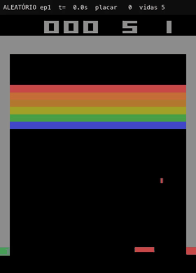
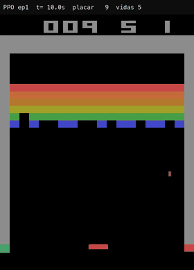
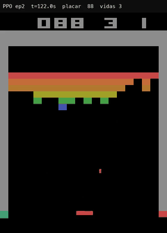
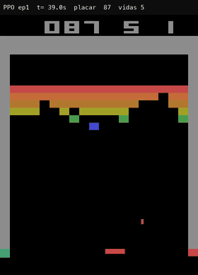
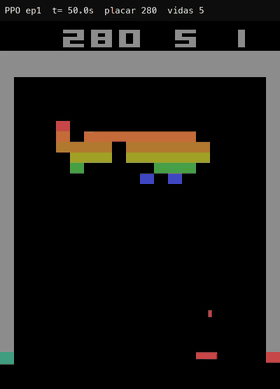

# Breakout com PPO: ensinando um agente a jogar Atari

Agente de **Aprendizado por Reforço** treinado com **PPO**
([Stable-Baselines3](https://stable-baselines3.readthedocs.io)) para jogar **Breakout** do Atari
2600 (`ALE/Breakout-v5`). O agente aprende **só olhando os pixels da tela e recebendo pontos**,
sem que ninguém explique as regras do jogo.

Trabalho final da disciplina de Aprendizado por Reforço (IBMEC 2026/2, Prof. Pedro Calais), feito
por **Vitor Neves de Lima**. A entrega é o notebook
[`notebooks/breakout_ppo.ipynb`](notebooks/breakout_ppo.ipynb), organizado pelos itens **a–m** do
enunciado.

| Antes do treino (aleatório) | Depois do treino (PPO) |
|:---:|:---:|
|  |  |
| **1,7 pontos** por partida | **355 pontos** por partida |

## Em resumo

- De **1,7** (aleatório) para **355 ± 38** pontos por partida (média de 20 partidas, máximo 423).
- Isso é **~11×** a referência humana do paper do DQN (31,8 pontos).
- Fica na mesma ordem do **DQN da DeepMind** publicado na *Nature* (401 pontos com 50 milhões de
  frames). Este agente usou 40 milhões de frames num notebook.
- Passou a referência humana com **33 minutos** de treino. **Tempo total de treino: ~4,7 h** num
  MacBook Air M3: 3,7 h do treino principal de 10 milhões de passos (de onde vêm os resultados
  abaixo) e ~1 h de treino extra feito à parte.
- Descobriu **sozinho** a estratégia do **túnel**.

## O que o agente precisa aprender

O objetivo é **maximizar a pontuação**: rebater a bola com a raquete e quebrar o máximo de tijolos
antes de perder as 5 vidas. Para isso, partindo só da imagem, o agente precisa:

1. **Achar a bola e a raquete na tela.** Ele recebe pixels, não coordenadas.
2. **Prever para onde a bola vai.** Por isso recebe os **4 últimos frames** empilhados: com um só
   não dá para saber a direção.
3. **Mover a raquete a tempo**, com 4 ações: `NOOP` (parado), `FIRE` (lança a bola), `RIGHT` e
   `LEFT`.
4. **Não deixar a bola cair**, porque cada bola perdida custa uma vida.
5. **Planejar no longo prazo** (γ = 0,99): às vezes vale mais mirar num ponto que rende muitos
   pontos depois do que só rebater.

**Recompensa:** cada tijolo dá pontos (1, 4 ou 7, conforme a fileira). No treino a recompensa é
recortada para +1 por tijolo, como no paper do DQN.

## Vídeos

### Jogada inteligente: o túnel

O agente concentra as rebatidas num lado até abrir um buraco no muro. A bola passa e fica presa
entre o muro e o teto, quebrando sozinha os tijolos de cima, que valem mais. O placar vai de
**86 para 313 em 16 segundos**. Ninguém programou isso: a estratégia surgiu porque o agente
maximiza a recompensa futura.



### Jogadas "burras"

| Esquece o FIRE (versão greedy) | Bola rápida |
|:---:|:---:|
|  |  |
| Na versão que sempre escolhe a ação mais provável, depois de perder uma vida ele não aperta `FIRE` e o jogo trava. No treino o `FIRE` era automático no início de cada vida, então ele nunca precisou aprender. | Depois de ~300 pontos a bola acelera e a raquete encolhe. Ele teve pouca experiência nessa fase e perde as vidas em poucos segundos. |

### Vídeos completos (com placar e vidas)

| Vídeo | Conteúdo |
|---|---|
| [`random_policy.mp4`](reports/videos/random_policy.mp4) | política aleatória, item (f) |
| [`trained_policy.mp4`](reports/videos/trained_policy.mp4) | agente treinado, 2 partidas completas, item (k). O túnel aparece a partir de **2:01** |
| [`trained_policy_deterministic.mp4`](reports/videos/trained_policy_deterministic.mp4) | versão greedy, mostra o travamento por falta de `FIRE` |

Cada vídeo tem um CSV ao lado (`*_events.csv`) com o segundo de cada tijolo, vida perdida e
travamento. Foram usados para achar as jogadas do item (l).

## Resultados

### Pontuação (20 partidas completas, 5 vidas cada)

| Política | Média ± desvio | Mín. | Máx. |
|---|---|---|---|
| Aleatória | 1,7 ± 1,8 | 0 | 7 |
| **PPO `best_model`** (8,5M passos) | **355 ± 38** | 285 | 423 |
| PPO `final_model` (10M passos) | 366 ± 50 | 192 | 417 |
| PPO `best_model` com *sticky actions* (25%) | 131 ± 93 | 33 | 388 |

**Comparação:** humano de referência no paper do DQN = 31,8 · DQN (Mnih et al., 2015) = 401.

**Robustez:** o treino foi sem aleatoriedade nas ações. Avaliado com *sticky actions* (25% de
chance de a ação atrasar um passo, Machado et al., 2018), o agente cai para 131, mas continua ~4×
acima do humano. Ou seja, ele aprendeu a jogar, não só decorou uma sequência.

### Curva de aprendizado


| Pontuação média (últimas 100 partidas) | Passos | Tempo de treino |
|---|---|---|
| 10 | 0,24M | 7 min |
| 30 (“minimamente inteligente”, item i) | 1,33M | 33 min |
| 100 | 3,35M | 1h15 |
| 200 | 5,04M | 1h51 |
| 300 | 7,41M | 2h49 |
| fim do treino | 10M | 3h43 |

Print do TensorBoard: [`reports/figures/tensorboard.png`](reports/figures/tensorboard.png).

## Como funciona

### Técnicas de RL usadas

| Técnica | Como aparece aqui |
|---|---|
| **Retorno descontado** | γ = 0,99: uma recompensa daqui a ~100 passos ainda conta |
| **Exploração × explotação** | no treino a política é estocástica (sorteia ações) com bônus de entropia `ent_coef = 0,01`. Na avaliação também é possível usar a ação mais provável (greedy) |
| **Ator-crítico** | o ator escolhe a ação, o crítico estima quanto vale o estado |
| **GAE** (λ = 0,95) | estimativa de vantagem com menos variância |
| **PPO com clip** (0,1, decaindo) | impede que a política mude demais numa única atualização |
| **Recompensa moldada** | recompensa recortada em +1 e fim de episódio a cada vida perdida, só no treino |

### A rede (item j)

Nature CNN, a mesma arquitetura do paper do DQN, com **1.686.693 parâmetros**:

```
entrada 84×84×4 → Conv 8×8 (32) → Conv 4×4 (64) → Conv 3×3 (64) → Densa 512 ─┬→ Ator: 4 ações
                                                                            └→ Crítico: valor do estado
```

A camada densa concentra ~95% dos parâmetros (1.606.144).

### Ajustes em relação ao código base (item h)

O código base do professor (feito para Freeway) não aprende Breakout como estava. Comparação
completa em [`configs/baseline_professor.yaml`](configs/baseline_professor.yaml) vs.
[`configs/ppo_breakout.yaml`](configs/ppo_breakout.yaml):

| Parâmetro | Base | Este trabalho | Por quê |
|---|---|---|---|
| Frame stack | não | **4** | sem ele o agente não vê a direção da bola |
| Ambientes paralelos | 1 | **8** | mais experiência por segundo |
| Frameskip | 4 × 4 = 16 (bug) | **4** | o v5 e o `AtariWrapper` pulavam frames duas vezes |
| `n_steps` / `n_epochs` | 2048 / 10 | **128 / 4** | hiperparâmetros do RL Zoo para Atari |
| `clip_range` | 0,2 | **0,1 linear** | atualizações mais estáveis |
| Learning rate | 2,5e-4 | **2,5e-4 linear** | decai até 0 no fim do treino |
| `ent_coef` | 0 | **0,01** | mantém exploração |
| Passos totais | 50 mil | **10 milhões** | Breakout é bem mais difícil que Freeway |

## Estrutura

```
notebooks/breakout_ppo.ipynb  entrega: itens a–m com código, gráficos e vídeos
configs/                      hiperparâmetros versionados (YAML)
  ppo_breakout.yaml           experimento principal (10M passos, 8 envs, frame stack 4)
  baseline_professor.yaml     parâmetros do código base aplicados ao Breakout
  smoke.yaml                  execução de ~1 min para validar o pipeline
src/breakout_rl/
  envs.py                     ambientes de treino/avaliação (AtariWrapper + VecFrameStack)
  train.py                    treino com checkpoints, avaliação periódica e --resume
  callbacks.py                registra quando cada pontuação foi atingida (item i)
  record.py                   vídeos com placar + CSV de eventos (itens f, k, l)
  evaluate.py                 pontuação média em N partidas
  model_info.py               contagem de parâmetros (item j)
  plots.py                    curvas do TensorBoard em PNG
  play.py                     jogar com o teclado (item b)
reports/
  models/best_model.zip       modelo treinado (20 MB)
  videos/                     vídeos MP4 + CSVs de eventos
  gifs/                       trechos curtos usados neste README
  figures/                    curvas, TensorBoard e quadros do túnel
  results/                    avaliações (JSON) e marcos de pontuação
scripts/                      setup, treino em background, parada segura, TensorBoard
tests/                        testes rápidos do pipeline
```

## Como rodar

Requisitos: Python 3.10–3.12 e [uv](https://docs.astral.sh/uv/).

```bash
make setup          # cria .venv e instala tudo
make test           # testes rápidos
make play           # item (b): jogue você mesmo (← → e ESPAÇO)
make random-video   # item (f): vídeo da política aleatória
```

### Usar o modelo já treinado

```bash
.venv/bin/python -m breakout_rl.evaluate --policy reports/models/best_model.zip --episodes 20
.venv/bin/python -m breakout_rl.record --policy reports/models/best_model.zip --episodes 1 --out reports/videos/meu_video.mp4
```

### Treinar do zero (Mac)

```bash
make train-bg       # caffeinate + nohup + --resume (retoma de checkpoint)
tail -f runs/ppo_breakout/train.log
make tensorboard    # http://localhost:6006
make stop           # para e salva checkpoint
```

- Mantenha o Mac na tomada. O treino usa a GPU do Apple Silicon (MPS): ~760 passos/s contra ~255
  em CPU num M3 de 8 GB.
- Checkpoints a cada 250 mil passos em `runs/ppo_breakout/checkpoints/` (ignorado no git).

### Depois do treino

```bash
make trained-video  # item (k) + CSV de eventos (item l)
make evaluate       # pontuação média em 20 partidas
make plots          # curvas em reports/figures/
make params         # item (j)
```

## Decisões técnicas

| Decisão | Motivo |
|---|---|
| PPO (e não DQN) | é o algoritmo do código base e usa pouca memória. O replay buffer do DQN para Atari ocupa ~3–6 GB, o que aperta um Mac de 8 GB |
| Treino local, não Colab | o Colab gratuito desconecta por inatividade e encerra sessões em até ~12 h; aqui o treino roda em segundo plano e retoma de checkpoints |
| Monitor antes do `AtariWrapper` | `ep_rew_mean` mostra a pontuação real da partida (5 vidas, sem recorte) |
| Configuração em YAML, copiada para `runs/<nome>/` | experimento reproduzível e comparável |

## Solução de problemas

- **`ModuleNotFoundError: breakout_rl` no macOS:** o `.pth` da instalação editável pode receber a
  flag `hidden`, e o Python 3.12+ ignora arquivos assim. Rode
  `chflags nohidden .venv/lib/python3.12/site-packages/*.pth` (o `make setup` já faz isso). Os
  alvos do `make` também definem `PYTHONPATH=src`.

## Referências

- Mnih et al. (2015). *Human-level control through deep reinforcement learning.* Nature.
- Schulman et al. (2017). *Proximal Policy Optimization Algorithms.*
- Machado et al. (2018). *Revisiting the Arcade Learning Environment.*
- Raffin et al. (2021). *Stable-Baselines3* e [RL Baselines3 Zoo](https://github.com/DLR-RM/rl-baselines3-zoo).
