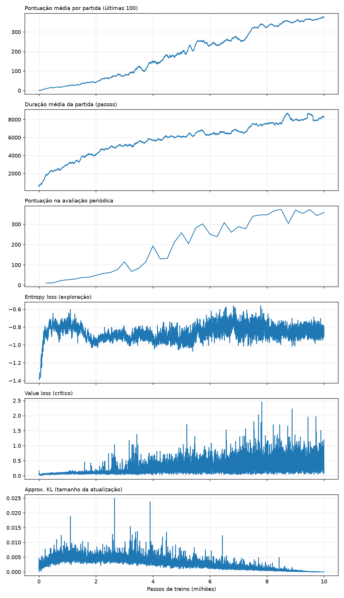

# Breakout com PPO: Aprendizado por Reforço

Agente treinado com **PPO** ([Stable-Baselines3](https://stable-baselines3.readthedocs.io)) para
jogar **Breakout** do Atari 2600 (`ALE/Breakout-v5`). Este é o trabalho final da disciplina de
Aprendizado por Reforço (IBMEC 2026/2, Prof. Pedro Calais).

A entrega é o notebook [`notebooks/breakout_ppo.ipynb`](notebooks/breakout_ppo.ipynb), organizado
pelos itens **a–m** do enunciado.

## Resultados

| Política | Pontos por partida (20 partidas) |
|---|---|
| Aleatória | 1,7 ± 1,8 |
| **PPO `best_model`** (8,5M passos) | **355 ± 38** (máx. 423) |
| PPO `final_model` (10M passos) | 366 ± 50 |

- 10M passos em **3,7 h** num MacBook Air M3 (GPU via MPS).
- Média de 30 pontos ("minimamente inteligente") após **1,33M passos / ~33 min**.
- O agente descobriu sozinho a estratégia do **túnel**: abre um buraco na lateral e deixa a bola
  quebrar o muro por cima.
- Rede: Nature CNN com **1.686.693 parâmetros**.



## Estrutura

```
configs/                  hiperparâmetros versionados (YAML)
  ppo_breakout.yaml       experimento principal (10M passos, 8 envs, frame stack 4)
  baseline_professor.yaml parâmetros do código base (Freeway) aplicados ao Breakout
  smoke.yaml              execução de ~1 min para validar o pipeline
src/breakout_rl/
  config.py               dataclasses da configuração
  envs.py                 ambientes de treino/avaliação (AtariWrapper + VecFrameStack)
  train.py                treino com checkpoints, avaliação periódica e --resume
  callbacks.py            MilestoneCallback: quando cada pontuação foi atingida (item i)
  record.py               vídeos com faixa de placar + CSV de eventos (itens f, k, l)
  evaluate.py             pontuação média em N partidas
  model_info.py           contagem de parâmetros da rede (item j)
  plots.py                curvas do TensorBoard em PNG
  play.py                 jogar com o teclado (item b)
scripts/                  setup, treino em background, parada segura, TensorBoard
notebooks/                notebook de entrega
reports/                  vídeos e figuras que vão para o relatório
runs/                     (ignorado no git) logs, checkpoints e modelos
tests/                    testes rápidos do pipeline
```

## Como rodar

Requisitos: Python 3.10–3.12 e [uv](https://docs.astral.sh/uv/).

```bash
make setup          # cria .venv e instala tudo
make test           # testes rápidos
make smoke          # treino de 2 mil passos (pipeline ponta a ponta)
make random-video   # item (f): vídeo da política aleatória
make play           # item (b): jogue você mesmo (← → e ESPAÇO)
```

### Treino longo (Mac)

```bash
make train-bg       # = ./scripts/train_overnight.sh: caffeinate + nohup + --resume
tail -f runs/ppo_breakout/train.log
make tensorboard    # http://localhost:6006
make stop           # para e salva checkpoint; make train-bg retoma de onde parou
```

- Mantenha o Mac **na tomada e com a tampa aberta**. O `caffeinate -i` impede o sono do sistema
  enquanto o treino roda.
- O treino detecta a GPU do Apple Silicon (MPS). Num M3 com 8 GB a velocidade medida foi de
  **~760 passos/s em MPS contra ~255 em CPU**, então 10M passos levam **~4 h**, mais o tempo das
  avaliações periódicas.
- Checkpoints a cada 250 mil passos em `runs/ppo_breakout/checkpoints/`. O melhor modelo da
  avaliação periódica fica em `runs/ppo_breakout/best_model/best_model.zip`.

### Depois do treino

```bash
make trained-video  # item (k): vídeo + reports/videos/trained_policy_events.csv (item l)
make evaluate       # pontuação média em 20 partidas
make plots          # curvas em reports/figures/
make params         # item (j)
```

Depois abra o notebook e preencha as partes marcadas com _preencher_.

## Por que local e não Colab?

O Colab gratuito desconecta por inatividade e encerra sessões em até ~12 h, o que é arriscado
para um treino longo. No Mac o treino fica em segundo plano e retoma de checkpoints. O notebook
também funciona no Colab: a primeira célula clona este repositório, que precisa ser público para
isso.

## Decisões técnicas

| Decisão | Motivo |
|---|---|
| PPO (e não DQN) | é o algoritmo do código base; usa pouca memória (o replay buffer do DQN para Atari, com 100 mil transições, ocupa ~3–6 GB, o que aperta um Mac de 8 GB) |
| Hiperparâmetros do RL Zoo para Atari | ajuste de referência para PPO em Atari |
| `frameskip=1` no `gym.make` | o `AtariWrapper` já pula 4 frames; o padrão do v5 resultaria em 16 |
| Monitor antes do AtariWrapper | `ep_rew_mean` mostra a pontuação real da partida (5 vidas, sem clipping) |
| Configuração em YAML + cópia em `runs/<nome>/config.yaml` | experimento reproduzível e comparável |

## Solução de problemas

- **`ModuleNotFoundError: breakout_rl` no macOS:** o `.pth` da instalação editável pode receber
  a flag `hidden`, e o Python 3.12+ ignora arquivos assim. Rode
  `chflags nohidden .venv/lib/python3.12/site-packages/*.pth` (o `make setup` já faz isso). Os
  alvos do `make` também definem `PYTHONPATH=src`.
